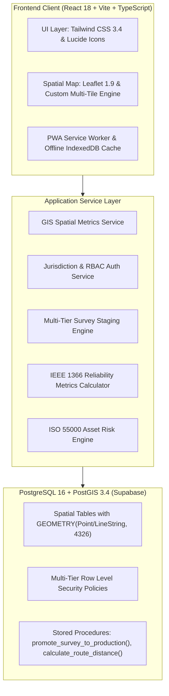

# PowerGIS - Enterprise Electricity Distribution GIS & Asset Management Platform

[](https://powergis.internal)
[](https://postgis.net)
[](https://reactjs.org)
[](https://tailwindcss.com)
[](https://standards.ieee.org)
[](https://www.iso.org)

---

## 1. Executive Summary & Organizational Scope

The **PowerGIS Enterprise Electricity Distribution GIS, Asset Management & O&M Platform** is a production-grade, enterprise utility operations system developed by **PowerGIS**.

### All Four Geographically Distinct Enclaves Covered:
1. **Puducherry** (Urban Boulevard, Semi-urban, and Rural Circles)
2. **Karaikal** (Coastal agricultural and port division)
3. **Mahe** (Arabian Sea coastal enclave)
4. **Yanam** (Godavari delta enclave)

### Official 5-Tier O&M Organizational Hierarchy:
$$\text{Superintending Engineer (SE)} \longrightarrow \text{Executive Engineer (EE)} \longrightarrow \text{Assistant Executive Engineer (AEE)} \longrightarrow \text{Assistant Engineer (AE)} \longrightarrow \text{Junior Engineer (JE)}$$
- **3 Configurable SE Accounts**:
  - Superintending Engineer (Circle I - Urban Puducherry)
  - Superintending Engineer (Circle II - Rural Puducherry)
  - Superintending Engineer (Karaikal, Mahe & Yanam Circle)

---

## 2. Key Modules & Technical Capabilities

| Module | Core Functionality & Engineering Standards |
|---|---|
| **Multi-Basemap GIS Master Map** | 8 Selectable basemaps: Google Maps (Roadmap, Satellite, Hybrid, Terrain), OSM Standard, OSM HOT, Esri World Imagery & Topo. 20 overlay layers, distance/area measurement, spatial coordinate search. |
| **Strict Jurisdiction Security (RLS)** | Multi-tier Row-Level Security in PostgreSQL: JE sees only assigned ward; AE only assigned section; EE only assigned division; SE assigned region; Contractor assigned tasks only. |
| **Electrical Asset Register** | Substations (230kV to 33kV), Feeders (22kV, 11kV, LT), DT Transformers, Utility Poles (PSCC 9m, Steel 11m, Rail), Conductors, Streetlights, Consumers. |
| **Smart Meter Management (AMI)** | Smart meters vs conventional meters, last communication timestamp, RF Mesh/4G status, transformer & pole mapping, tamper alerts. |
| **Warranties & Lifecycle Register** | Equipment useful life vs current age, 30/60/90-day expiry notifications, batch warranties, scrap & disposal register. |
| **Fault Management & Distance Engine** | Automated spatial calculation: GPS fault pin, straight-line distance to nearest pole & DT, distance along feeder LineString route, distance to section office. |
| **Work Order Kanban Board** | Field gang dispatch, status advancement (Assigned $\to$ In Progress $\to$ Completed $\to$ Verified $\to$ Closed), material consumption evidence. |
| **Contractor GPS Field Survey (PWA)** | Mobile-first offline PWA with live GPS accuracy meter, photo uploads, IndexedDB queue, and offline conflict resolver. |
| **Multi-Tier Survey Approval Workflow** | Contractor Draft $\to$ JE Verification $\to$ AE Approval $\to$ Atomic Stored Procedure promotion into production PostGIS tables. |
| **SCADA Telemetry & Interactive SLD** | Real-time voltage/current/power factor monitoring, breaker trip/close simulation, active substation alarm console. |
| **IEEE 1366 Reliability Indices** | Automated calculation of SAIFI, SAIDI, CAIDI, MAIFI, and Energy Not Served (ENS in MWh) for JERC regulatory compliance. |
| **Network Topology Tracing** | Upstream tracing to substation source circuit breaker and downstream tracing to affected distribution transformers and consumers. |
| **Preventive Maintenance Scheduler** | Thermographic infrared inspection logging, transformer oil BDV dielectric testing, earth resistance compliance tracking. |
| **DT Loading & Phase Imbalance** | Real-time phase current tracking ($I_R, I_Y, I_B$), neutral current monitoring, thermal overload alerts ($>85\%$), capacity utilization. |
| **Stores & Inventory Management** | Real-time stock levels of transformers, poles, cables, and smart meters across regional stores with automated reorder alerts. |
| **Disaster Response & Cyclone SOP** | Cyclone hazard protocols, mobile DG sets, emergency restoration system (ERS) deployment tracking, reserve poles. |
| **Safety Management (Permit to Work - PTW)**| Line clear requests, mandatory 5-step safety isolation verification, temporary earthing confirmation, digital PTW issue. |
| **ISO 55000 Asset Risk Scoring** | Multi-factor risk engine: Composite Risk = $0.30 \times \text{Condition} + 0.25 \times \text{Age} + 0.20 \times \text{Loading} + 0.15 \times \text{Faults} + 0.10 \times \text{Criticality}$. |
| **System Administration & Backup** | Automated PostgreSQL dump simulation, geo-redundant snapshots, audit log viewer, role emulator. |
| **Dedicated Enterprise Login** | Staff authentication with username/email and password, failed attempt counter with account lockout protection, and development-only 1-click test persona switcher, including a read-only Demo User. |

---

## 3. Technology Architecture



---

## 4. Getting Started Locally

### Prerequisites
- Node.js 22 or higher
- npm 10.9.2 or compatible npm 10+

### Installation & Run

```bash
# Clone the repository
git clone https://github.com/SubhashProjects/PowerGIS.git
cd PowerGIS

# Install the exact dependency graph
npm ci

# Copy .env.example to .env.local and set VITE_SUPABASE_URL / VITE_SUPABASE_ANON_KEY
# (public browser values only; never use service-role or gateway secrets here)

# Start development server (loopback only)
npm run dev
```

Visit `http://localhost:5173` in your browser.

---

## 5. Automated Verification & Testing

The system includes an extensive 41-test automated suite covering zero-trust jurisdiction security, multi-tier survey promotion, spatial distance calculations, IEEE 1366 reliability, ISO 55000 asset health indexing, and staff authentication with lockout protection:

```bash
# Execute automated test suite
npx tsx tests/security_and_functional.test.ts
```

Output:
```
============================================================
 POWERGIS ENTERPRISE - AUTOMATED TEST SUITE EXECUTION
============================================================
--- TEST GROUP 1: Role Permissions & Authorization ---
  ✓ PASS: Super Admin can manage users
  ✓ PASS: Super Admin can configure system
  ✓ PASS: Contractor can submit surveys
  ✓ PASS: Contractor CANNOT approve surveys
  ✓ PASS: Contractor CANNOT manage users
  ✓ PASS: JE can verify field surveys
  ✓ PASS: JE CANNOT give final AE approval
  ✓ PASS: Auditor CANNOT edit assets (Read-Only)
  ✓ PASS: Auditor can export data for regulatory reports

--- TEST GROUP 2: Strict Jurisdiction Segregation ---
  ✓ PASS: JE Anand can access his assigned Marapalam Ward
  ✓ PASS: SECURITY: JE Anand CANNOT access Karaikal jurisdiction
  ✓ PASS: EE Urban can access subordinate Marapalam section
  ✓ PASS: SECURITY: EE Urban CANNOT access Karaikal division records
  ✓ PASS: Super Admin can access Puducherry
  ✓ PASS: Super Admin can access Karaikal

--- TEST GROUP 3: Multi-Tier Survey Staging & Approval Workflow ---
  ✓ PASS: Survey submitted by contractor enters submitted state
  ✓ PASS: SECURITY: Staged asset does NOT appear in live GIS prior to approval
  ✓ PASS: Survey status advances to je_verified
  ✓ PASS: SECURITY: Staged asset still NOT in live GIS after JE verification alone
  ✓ PASS: AE approval promoted 1 staging asset to live GIS
  ✓ PASS: Survey status is now ae_approved
  ✓ PASS: Verified asset is now published to live production GIS
  ✓ PASS: SECURITY: Rejection without mandatory reason is strictly rejected

--- TEST GROUP 4: Fault Distance & Network Proximity Engine ---
  ✓ PASS: Calculates distance from nearest pole (straight-line)
  ✓ PASS: Calculates distance from nearest DT
  ✓ PASS: Calculates distance along feeder route (LineString projection)
  ✓ PASS: Calculates distance from section office

--- TEST GROUP 5: IEEE 1366 Reliability Indices ---
  ✓ PASS: Calculates SAIFI index (System Average Interruption Frequency)
  ✓ PASS: Calculates SAIDI index (System Average Interruption Duration)
  ✓ PASS: Calculates CAIDI index (Customer Average Interruption Duration)
  ✓ PASS: Calculates Energy Not Served (ENS in MWh)

--- TEST GROUP 6: ISO 55000 Asset Risk Scoring ---
  ✓ PASS: Calculates composite risk score within 0-100 range
  ✓ PASS: Assigns risk category (Low/Moderate/High/Critical)
  ✓ PASS: Generates ISO 55000 engineering action plan

--- TEST GROUP 7: Authentication & Test Credentials ---
  ✓ PASS: Valid official credentials login succeeds
  ✓ PASS: Session state reflects authenticated
  ✓ PASS: Development-only simulator credential fixture succeeds (never used by production authentication)
  ✓ PASS: Invalid credentials strictly rejected
  ✓ PASS: 1-Click persona login authenticates contractor
  ✓ PASS: Password reset token dispatched successfully
  ✓ PASS: Logout terminates active session

============================================================
 TEST EXECUTION SUMMARY: 41 PASSED, 0 FAILED
============================================================
```

---

## 6. Building for Production

```bash
# Compile TypeScript and bundle production assets
npm run build
```
Production assets will be output to the `dist/` folder, ready for deployment to any static host, CDN, or Supabase Storage bucket.

---

## 7. Database Migrations & Supabase Setup

To deploy the database on Supabase Cloud or PostgreSQL 16 + PostGIS:
1. Back up the target database and validate the target project/environment.
2. Apply every timestamped file in `supabase/migrations/` in lexical order using the Supabase CLI or an approved migration runner. Do not apply only the early baseline migrations.
3. The generated `supabase/SUPABASE_ALL_IN_ONE_MASTER.sql` contains migrations only and is intended for a fresh, isolated database after review. It excludes demo seed data.
4. `supabase/seed.sql` contains illustrative demo personas and operational fixtures. Use it only in an isolated development/staging project; never execute it in production.
5. The login screen provides a **Demo User** persona (`demo.viewer@example.test`, username `demo_viewer`) through **Demo Roles**. It is a simulated, read-only Auditor profile and is available only in a Vite development build without Supabase configured. Select **Sign in** on its persona card; there is no demo password. Password-based login is deliberately rejected when Supabase Auth is not configured.
6. Configure `POWERGIS_ALLOWED_ORIGINS` and any gateway-only tokens as Supabase Edge Function secrets. Browser build variables must contain only the Supabase URL and public anon/publishable key.

---

## 8. Deployment & Version Control

- **Repository**: [https://github.com/SubhashProjects/PowerGIS](https://github.com/SubhashProjects/PowerGIS)
- **Author**: PowerGIS Enterprise GIS & Utility Systems

---

## V2.1.0 / V3.1 security patch

This source archive includes targeted authentication, jurisdiction, PTW safety, GPS provenance, offline-queue, admin-action, and theme-toggle corrections. Read [`docs/POWERGIS_V3.1_PATCH_NOTES.md`](docs/POWERGIS_V3.1_PATCH_NOTES.md) before deployment. This is not a production-readiness certification: several business modules still use local/in-memory data, and SCADA gateway, full PTW workflow, offline server synchronization, and backup/restore require further implementation and live testing.

**Important:** The prebuilt static bundles in `dist/`, `docs/`, `portal/`, and `assets/` have not been regenerated in this archive. Run `npm ci` and `npm run build` before publishing the updated source.

## V3.2.1 follow-up hardening

The repository includes the V3.2.1 follow-up hardening pass covering concurrency-safe identifiers, server-confirmed contractor offline synchronization, private PTW/survey evidence storage, server-side Auth administration, operational asset bootstrap, and additional RLS corrections. See `docs/POWERGIS_V3.2.1_PATCH_NOTES.md`.

Full production verification still requires installing dependencies and running the application against a dedicated Supabase staging project; the source package intentionally does not claim successful live E2E, RLS-concurrency, or backup/restore validation when those environments are unavailable.

## Latest release

PowerGIS 3.15.0 — Offline GIS & Field Evidence. See `docs/POWERGIS_V3.15.0_OFFLINE_GIS_FIELD_EVIDENCE.md` for implementation details, operational boundaries, and verification instructions.


## PowerGIS 3.13.0 – Complete Offline-First Operations

PowerGIS 3.13.0 adds a durable IndexedDB operational mutation queue, stable idempotent replay, connectivity-aware queueing for fault/outage/work-order/PTW/inventory commands, retry backoff, cross-tab replay leases, conflict blocking, and an expanded Sync Center. See `docs/POWERGIS_V3.13.0_OFFLINE_FIRST_OPERATIONS.md` for behavior and limitations.

## PowerGIS 3.14.0 – GIS Network Intelligence

The Network Topology workspace now includes feeder-level upstream/downstream relationship summaries, linked active-consumer impact counts, feeder utilization, transformer loading and phase-imbalance indicators. The integrity analyzer flags duplicate identifiers, missing substation references, orphan assets, missing conductor endpoints, disconnected conductor-graph nodes and capacity exceptions. Findings are computed from the currently loaded and jurisdiction-filtered asset records; they are advisory and are not a live power-flow solver or an approved switching/isolation instruction.

Run the focused analysis tests with `npx tsx tests/network_intelligence.test.ts` when project dependencies are installed.

## PowerGIS 3.14.0 – GIS Network Intelligence & Topology Validation

PowerGIS 3.14.0 adds feeder relationship tracing, network integrity diagnostics, disconnected conductor-graph candidates, feeder/transformer capacity screening and active consumer impact summaries. See `docs/POWERGIS_V3.14.0_NETWORK_INTELLIGENCE.md` for scope, safety boundaries and verification details.

## PowerGIS 3.15.0 — Offline GIS & Field Evidence

PowerGIS 3.15.0 adds a device-local Offline GIS workspace for GeoJSON work areas, explicit local edit review, and 1 MiB chunked evidence persistence with SHA-256 verification. It does not claim basemap tile caching or automatic authoritative server synchronization; see `docs/POWERGIS_V3.15.0_OFFLINE_GIS_FIELD_EVIDENCE.md` for safety boundaries and verification instructions.

## PowerGIS 3.16.0 — Electrical Network Intelligence

PowerGIS 3.16.0 extends the existing topology workspace with a phase-aware connected-component trace, explicit switch-state handling, phase coverage summaries, optional conductor phase/energization metadata, and stable-ID network snapshot comparison. Missing phase or switch information remains unknown; the trace is not a live electrical state estimator, directed upstream/downstream proof, protection study, or switching instruction. See `docs/POWERGIS_V3.16.0_ELECTRICAL_NETWORK_INTELLIGENCE.md` for scope and data-safety boundaries.

## PowerGIS 3.17.0 — Asset Lifecycle Management

The Asset Lifecycle workspace extends the canonical asset registry with backend-backed lifecycle registration, condition assessments, replacement prioritisation, expected-life tracking and append-only assessment history. Apply `supabase/migrations/20261117_asset_lifecycle_management.sql` before using lifecycle writes. See `docs/POWERGIS_V3.17.0_ASSET_LIFECYCLE_MANAGEMENT.md` for scope and deployment boundaries.

## PowerGIS 3.25.0 — Enterprise Operations & Intelligence

The cumulative 3.25.0 source carries forward the 3.18–3.24 operational capabilities and adds an integrated Enterprise Planning workspace. It consolidates explainable replacement, warranty, inventory and work-order exception recommendations; a straight-line depreciation estimator; and printable human-readable asset identity labels based on canonical asset IDs. Recommendations navigate to existing modules and do not mutate operational records. Financial values are estimates only; no accounting ledger posting is performed. The label is not a QR/barcode generator or scanner. See `docs/POWERGIS_V3.25.0_ENTERPRISE_OPERATIONS_INTELLIGENCE.md` for the release matrix and boundaries.

The 3.25.0 verification performed for this source archive includes all static `.mjs` tests, syntax transpilation of 150 TypeScript/TSX files, relative import resolution, and ZIP integrity. A full Vite production build and live Supabase/RLS/SCADA/AMI integration tests were not run. Existing prebuilt bundles must be regenerated by running `npm ci` and `npm run build` in a deployment environment before publishing.

## PowerGIS 3.32.0 — Platform Engineering & Field Operations

The cumulative 3.26–3.32 release adds a Platform Engineering & Operations Centre with static navigation audit, utility integration catalogue, validated-input electrical screening calculations, jurisdiction-bound consumer connection application intake, canonical network snapshot, deployment readiness checks and a mobile field entry point to the existing Contractor PWA/Offline GIS/offline mutation queue. It also adds a read-only telemetry-ingest Edge Function for bounded, validated, duplicate-safe frames from explicitly enabled/commissioned gateway registry entries, plus an app-shell PWA manifest and service worker that excludes API/auth/storage/function requests from caching. Consumer service applications are not live consumer connections; the network snapshot is not a live digital twin; engineering results are not approved studies; and external protocol gateways remain uncommissioned. Apply `supabase/migrations/20261127_platform_evolution_326_332.sql` before enabling consumer request persistence. Run `npm run audit` for the source/navigation/import architecture audit and `npm run test:static` for the full static regression suite. See `docs/POWERGIS_V3.26_TO_V3.32_PLATFORM_EVOLUTION.md` for deployment and verification boundaries.

The source-level checks include all static `.mjs` tests and runtime checks of the new pure calculation/validation services. A full dependency install, Vite production build, live Supabase/RLS validation, SCADA/AMI commissioning and Android device certification were not performed. Run `npm ci && npm run build` and deploy to a staging Supabase project before production use.

## PowerGIS 3.42.0 — Completion & Stabilization Edition

This is a consolidation release, not a feature expansion. It aligns release metadata and PWA cache identity, regenerates the all-in-one SQL from the ordered migration set, and adds a release-readiness audit for migration/master-SQL parity, PWA assets, version consistency, and accidental backend-secret exposure in browser-delivered source. No new product modules or user-facing workflows are introduced. See `docs/POWERGIS_V3.33_TO_V3.42_COMPLETION_STABILIZATION.md` for the scope and the explicit boundary between source-level checks and validation that still requires a live Supabase/staging environment.

Run `npm run test:static` to execute the platform audit, static regression suite, and release-readiness gate. Full dependency-backed build validation requires `npm ci` followed by `npm run test:platform-runtime`, `npm test`, and `npm run build`.
