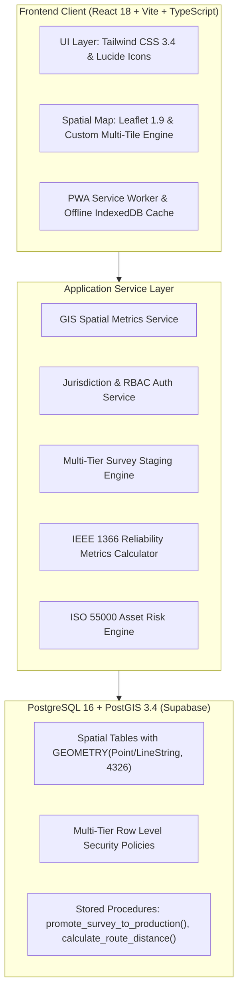

# PowerGIS - Enterprise Electricity Distribution GIS & Asset Management Platform

[](https://powergis.internal)
[](https://postgis.net)
[](https://reactjs.org)
[](https://tailwindcss.com)
[](https://standards.ieee.org)
[](https://www.iso.org)

---

## 1. Executive Summary & Organizational Scope

The **PowerGIS Enterprise Electricity Distribution GIS, Asset Management & O&M Platform** is a production-grade, enterprise utility operations system developed by **PowerGIS**.

### All Four Geographically Distinct Enclaves Covered:
1. **Puducherry** (Urban Boulevard, Semi-urban, and Rural Circles)
2. **Karaikal** (Coastal agricultural and port division)
3. **Mahe** (Arabian Sea coastal enclave)
4. **Yanam** (Godavari delta enclave)

### Official 5-Tier O&M Organizational Hierarchy:
$$\text{Superintending Engineer (SE)} \longrightarrow \text{Executive Engineer (EE)} \longrightarrow \text{Assistant Executive Engineer (AEE)} \longrightarrow \text{Assistant Engineer (AE)} \longrightarrow \text{Junior Engineer (JE)}$$
- **3 Configurable SE Accounts**:
  - Superintending Engineer (Circle I - Urban Puducherry)
  - Superintending Engineer (Circle II - Rural Puducherry)
  - Superintending Engineer (Karaikal, Mahe & Yanam Circle)

---

## 2. Key Modules & Technical Capabilities

| Module | Core Functionality & Engineering Standards |
|---|---|
| **Multi-Basemap GIS Master Map** | 8 Selectable basemaps: Google Maps (Roadmap, Satellite, Hybrid, Terrain), OSM Standard, OSM HOT, Esri World Imagery & Topo. 20 overlay layers, distance/area measurement, spatial coordinate search. |
| **Strict Jurisdiction Security (RLS)** | Multi-tier Row-Level Security in PostgreSQL: JE sees only assigned ward; AE only assigned section; EE only assigned division; SE assigned region; Contractor assigned tasks only. |
| **Electrical Asset Register** | Substations (230kV to 33kV), Feeders (22kV, 11kV, LT), DT Transformers, Utility Poles (PSCC 9m, Steel 11m, Rail), Conductors, Streetlights, Consumers. |
| **Smart Meter Management (AMI)** | Smart meters vs conventional meters, last communication timestamp, RF Mesh/4G status, transformer & pole mapping, tamper alerts. |
| **Warranties & Lifecycle Register** | Equipment useful life vs current age, 30/60/90-day expiry notifications, batch warranties, scrap & disposal register. |
| **Fault Management & Distance Engine** | Automated spatial calculation: GPS fault pin, straight-line distance to nearest pole & DT, distance along feeder LineString route, distance to section office. |
| **Work Order Kanban Board** | Field gang dispatch, status advancement (Assigned $\to$ In Progress $\to$ Completed $\to$ Verified $\to$ Closed), material consumption evidence. |
| **Contractor GPS Field Survey (PWA)** | Mobile-first offline PWA with live GPS accuracy meter, photo uploads, IndexedDB queue, and offline conflict resolver. |
| **Multi-Tier Survey Approval Workflow** | Contractor Draft $\to$ JE Verification $\to$ AE Approval $\to$ Atomic Stored Procedure promotion into production PostGIS tables. |
| **SCADA Telemetry & Interactive SLD** | Real-time voltage/current/power factor monitoring, breaker trip/close simulation, active substation alarm console. |
| **IEEE 1366 Reliability Indices** | Automated calculation of SAIFI, SAIDI, CAIDI, MAIFI, and Energy Not Served (ENS in MWh) for JERC regulatory compliance. |
| **Network Topology Tracing** | Upstream tracing to substation source circuit breaker and downstream tracing to affected distribution transformers and consumers. |
| **Preventive Maintenance Scheduler** | Thermographic infrared inspection logging, transformer oil BDV dielectric testing, earth resistance compliance tracking. |
| **DT Loading & Phase Imbalance** | Real-time phase current tracking ($I_R, I_Y, I_B$), neutral current monitoring, thermal overload alerts ($>85\%$), capacity utilization. |
| **Stores & Inventory Management** | Real-time stock levels of transformers, poles, cables, and smart meters across regional stores with automated reorder alerts. |
| **Disaster Response & Cyclone SOP** | Cyclone hazard protocols, mobile DG sets, emergency restoration system (ERS) deployment tracking, reserve poles. |
| **Safety Management (Permit to Work - PTW)**| Line clear requests, mandatory 5-step safety isolation verification, temporary earthing confirmation, digital PTW issue. |
| **ISO 55000 Asset Risk Scoring** | Multi-factor risk engine: Composite Risk = $0.30 \times \text{Condition} + 0.25 \times \text{Age} + 0.20 \times \text{Loading} + 0.15 \times \text{Faults} + 0.10 \times \text{Criticality}$. |
| **System Administration & Backup** | Automated PostgreSQL dump simulation, geo-redundant snapshots, audit log viewer, role emulator. |
| **Dedicated Enterprise Login** | Staff authentication with username/email and password, failed attempt counter with account lockout protection, and 1-click test persona switcher. |

---

## 3. Technology Architecture



---

## 4. Getting Started Locally

### Prerequisites
- Node.js (v18 or higher)
- npm or yarn

### Installation & Run

```bash
# Clone the repository
git clone https://github.com/SubhashProjects/PowerGIS.git
cd PowerGIS

# Install dependencies
npm install

# Start development server
npm run dev
```

Visit `http://localhost:5173` in your browser.

---

## 5. Automated Verification & Testing

The system includes an extensive 41-test automated suite covering zero-trust jurisdiction security, multi-tier survey promotion, spatial distance calculations, IEEE 1366 reliability, ISO 55000 asset health indexing, and staff authentication with lockout protection:

```bash
# Execute automated test suite
npx tsx tests/security_and_functional.test.ts
```

Output:
```
============================================================
 POWERGIS ENTERPRISE - AUTOMATED TEST SUITE EXECUTION
============================================================
--- TEST GROUP 1: Role Permissions & Authorization ---
  ✓ PASS: Super Admin can manage users
  ✓ PASS: Super Admin can configure system
  ✓ PASS: Contractor can submit surveys
  ✓ PASS: Contractor CANNOT approve surveys
  ✓ PASS: Contractor CANNOT manage users
  ✓ PASS: JE can verify field surveys
  ✓ PASS: JE CANNOT give final AE approval
  ✓ PASS: Auditor CANNOT edit assets (Read-Only)
  ✓ PASS: Auditor can export data for regulatory reports

--- TEST GROUP 2: Strict Jurisdiction Segregation ---
  ✓ PASS: JE Anand can access his assigned Marapalam Ward
  ✓ PASS: SECURITY: JE Anand CANNOT access Karaikal jurisdiction
  ✓ PASS: EE Urban can access subordinate Marapalam section
  ✓ PASS: SECURITY: EE Urban CANNOT access Karaikal division records
  ✓ PASS: Super Admin can access Puducherry
  ✓ PASS: Super Admin can access Karaikal

--- TEST GROUP 3: Multi-Tier Survey Staging & Approval Workflow ---
  ✓ PASS: Survey submitted by contractor enters submitted state
  ✓ PASS: SECURITY: Staged asset does NOT appear in live GIS prior to approval
  ✓ PASS: Survey status advances to je_verified
  ✓ PASS: SECURITY: Staged asset still NOT in live GIS after JE verification alone
  ✓ PASS: AE approval promoted 1 staging asset to live GIS
  ✓ PASS: Survey status is now ae_approved
  ✓ PASS: Verified asset is now published to live production GIS
  ✓ PASS: SECURITY: Rejection without mandatory reason is strictly rejected

--- TEST GROUP 4: Fault Distance & Network Proximity Engine ---
  ✓ PASS: Calculates distance from nearest pole (straight-line)
  ✓ PASS: Calculates distance from nearest DT
  ✓ PASS: Calculates distance along feeder route (LineString projection)
  ✓ PASS: Calculates distance from section office

--- TEST GROUP 5: IEEE 1366 Reliability Indices ---
  ✓ PASS: Calculates SAIFI index (System Average Interruption Frequency)
  ✓ PASS: Calculates SAIDI index (System Average Interruption Duration)
  ✓ PASS: Calculates CAIDI index (Customer Average Interruption Duration)
  ✓ PASS: Calculates Energy Not Served (ENS in MWh)

--- TEST GROUP 6: ISO 55000 Asset Risk Scoring ---
  ✓ PASS: Calculates composite risk score within 0-100 range
  ✓ PASS: Assigns risk category (Low/Moderate/High/Critical)
  ✓ PASS: Generates ISO 55000 engineering action plan

--- TEST GROUP 7: Authentication & Test Credentials ---
  ✓ PASS: Valid official credentials login succeeds
  ✓ PASS: Session state reflects authenticated
  ✓ PASS: Universal test password PowerGIS@2026 succeeds
  ✓ PASS: Invalid credentials strictly rejected
  ✓ PASS: 1-Click persona login authenticates contractor
  ✓ PASS: Password reset token dispatched successfully
  ✓ PASS: Logout terminates active session

============================================================
 TEST EXECUTION SUMMARY: 41 PASSED, 0 FAILED
============================================================
```

---

## 6. Building for Production

```bash
# Compile TypeScript and bundle production assets
npm run build
```
Production assets will be output to the `dist/` folder, ready for deployment to any static host, CDN, or Supabase Storage bucket.

---

## 7. Database Migrations & Supabase Setup

To execute the database schema on Supabase Cloud or an In-House PostgreSQL 16 + PostGIS server:
1. Open the Supabase SQL Editor.
2. Run `supabase/migrations/20261108_puducherry_master_schema.sql` (Creates all tables, spatial indexes, PostGIS geometry types).
3. Run `supabase/migrations/20261108_rls_jurisdiction_policies.sql` (Enforces zero-trust RLS jurisdiction security).
4. Run `supabase/migrations/20261108_approval_workflow_rpc.sql` (Installs atomic staging-to-production promotion stored procedures).
5. Run `supabase/migrations/20261108_spatial_metrics_rpc.sql` (Installs nearest pole, nearest DT, and feeder route distance calculators).
6. Run `supabase/migrations/20261108_reliability_metrics_rpc.sql` (Installs IEEE 1366 SAIFI/SAIDI/CAIDI calculation functions).
7. Run `supabase/migrations/20261108_asset_risk_matrix.sql` (Installs ISO 55000 asset risk matrix engine).
8. Run `supabase/seed.sql` (Seeds all 4 regions, official user personas, substations, feeders, DTs, poles, consumers, SCADA, PTW, and stores data).

---

## 8. Deployment & Version Control

- **Repository**: [https://github.com/SubhashProjects/PowerGIS](https://github.com/SubhashProjects/PowerGIS)
- **Author**: PowerGIS Enterprise GIS & Utility Systems
